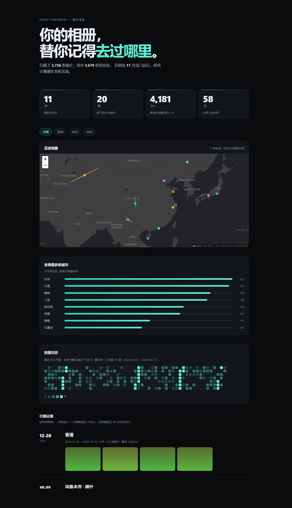

# 年轮 Rings · 把个人数据变成年度叙事

**在线体验 → https://setout472.github.io/rings/**
｜[看示例报告](https://setout472.github.io/rings/web/report.html?demo=1)
｜[看 66 秒演示](video/demo.mp4)

> 入口页 [index.html](index.html) ｜ 产品说明 [PRODUCT.md](PRODUCT.md) ｜ 部署 [DEPLOY.md](DEPLOY.md)
>
> 技术复盘（定稿）[docs/article.md](docs/article.md)
> ｜ 写作骨架 [docs/retrospective.md](docs/retrospective.md)
> ｜ 录屏分镜 [docs/demo-script.md](docs/demo-script.md)
>
> （代码包名仍叫 `wrapped`，产品名是后定的）


[](video/demo.mp4)

▶ **[看 66 秒演示](video/demo.mp4)** —— 画面是真实浏览器录屏（CDP 逐帧抓取），
配音由 Edge TTS 生成，全程可复现：`python video/build.py`

两个小工具，共用一个叙事引擎：

| 工具 | 输入 | 产出 |
|---|---|---|
| **照片足迹** | 相册目录（EXIF） | 足迹地图 + 年度回顾，单文件 HTML |
| **阅读 Wrapped** | 豆瓣/观影记录 CSV | 竖滑式年度报告，单文件 HTML |

两份产出都是**一个自包含的 HTML 文件**：可以直接发链接、发压缩包、丢 GitHub Pages，
断网也能打开（地图瓦片除外，且失败时自动降级成 SVG 轨迹简图）。



---

## 快速开始

不需要安装任何第三方依赖（有 Pillow + numpy 更好，没有也能跑，只是没有缩略图）。

```bash
# 1. 先看效果：生成 3 年、3000 张的合成数据 + 两份报告
python -m wrapped demo

# 2. 换成你自己的相册
python -m wrapped footprint --photos "D:/Pictures" --out out/my-footprint.html

# 3. 阅读报告
python -m wrapped reading --csv demo/books.csv --out out/my-reading.html --label 2024
```

打开 `out/footprint.html` 即可。

### 支持的 URL 参数（也是分享功能）

- `footprint.html#1` —— 直接定位到第 2 个年份标签
- `footprint.html?trip=2#1` —— 直接放大到第 3 次行程的路线

---

## 网页版：不用装任何东西

```bash
python -m wrapped webbuild      # 生成 web/js/cities.js、web/report.html、web/sample.json
python -m http.server 8931      # 必须在 HTTP 下打开（浏览器不让 file:// 用 sessionStorage）
```

然后访问 `http://localhost:8931/web/app.html`，把相册文件夹拖进去。

整个流水线都在浏览器里：手写的 EXIF 解析器读时间与坐标 → JS 版引擎做去重、漂移过滤、行程聚类
→ 报告页渲染。没有后端，没有上传，连地图库都是异步加载的（CDN 挂了就自动降级成 SVG 轨迹简图）。

> 直接看效果：`web/report.html?demo=1` 会加载预生成的示例，不需要任何照片。

---

## 示例数据：一个编出来的三年

`demo/` 里的数据是手写的，不是随机撒点。设定是一个在上海工作的人，2022–2024：

- **2022 年 3 月中旬到 6 月初，一张照片都没有**——这是整份报告里最像人的地方，
  打开 `#3`（2022 年）标签，日历上会留出一整块空白，文案写着「最长的一次沉默 83 天」。
- 2022 年 8 月解封后第一次远行，云南 8 天 366 张。
- 2023 年 3 月去北京出差 3 天，只拍了 29 张——只在会场和酒店附近。
- 2023 年 5 月第一次去日本，8 天 417 张，跨时区 UTC+9。
- 2024 年春节带爸妈去三亚；7 月大阪京都奈良；10 月国庆走南疆，最远 4,181km。

同时故意埋了四类脏数据，用来验证清洗逻辑真的在干活：

| 埋的坑 | 位置 | 报告里的体现 |
|---|---|---|
| 备份重复导入 36 张 | 2024-02-13 | 「重复记录合并 36 张」 |
| 山谷 GPS 漂移 5 个点 | 2022-08 大理 | 「判定为 GPS 漂移并剔除 5 个点」 |
| 相机拍的照片没有定位 | 2023-08-20 青岛 | 带 GPS 比例 98.5% |
| 换手机后只剩文件名时间 | 2024 年初某天 | 「时间只能从文件名取 6 张」 |

数据全部虚构，不对应任何真实的人。

---

## 阅读数据的 CSV 格式

列名做了模糊匹配，豆瓣导出、自己手打的表格都能用。最小要求：**标题 + 日期**。

```csv
标题,年份,我的评分,大众评分,标签,作者,日期
三体,2008,5,4.9,科幻/中国文学,刘慈欣,2024-03-02
```

- 评分支持 `4`、`4.5`、`4星`、`★★★★☆`、`8.6`（十分制自动换算）
- 标签用 `/ 、 , ；` 分隔都行
- 日期缺月份会按当月 1 日算

---

## 设计决策（面试时被追问的就是这些）

### 1. 「旅行」怎么定义

不是「离开家」，而是「离开家足够远、且连续」。参数全在 `trips.py` 顶部：

```python
AWAY_KM    = 100    # 超过 100km 才算离巢，避开城际通勤
GAP_HOURS  = 48     # 两次离家照片间隔超过 48h 就切成两段行程
MIN_PHOTOS = 3      # 少于 3 张照片不成立
MIN_MAX_KM = 150    # 行程最远点至少 150km
```

### 2. GPS 漂移怎么剔除

两条判据，都写清楚了为什么：

- **速度判据**：相邻两张照片算出的速度 > 900 km/h（亚音速客机约 850）视为不可能。
  但要求位移 > 50km —— 否则相隔 14 秒、相距 4 公里的两张连拍会算出 958 km/h 的假阳性。
- **距离判据**：一个点跟前后邻居都相距 3000km 以上，无论间隔多久都不可能是真的。

关键细节：只剔除「**两边都不合理**」的那个点。单边不合理的点通常是真实位移（落地后拍的第一张）。

### 3. 时区

EXIF 的 `DateTimeOriginal` 是**拍摄地当地时间**，不带时区。直接排序会让跨时区旅行出现「时间倒流」。
处理方式：用经纬度回算偏移量得到 UTC。

中国大陆范围直接按东八区处理（新疆地理上偏西，但官方时间仍是 +8）——这一条是踩出来的：
纯按经度算会把三亚（109°E）判成 UTC+7，凭空造出一批「跨时区照片」。

### 4. 隐私

全本地处理，不上传任何照片。缩略图压成 base64 内嵌进 HTML，所以：
- 报告是单个文件，不会因为移动相册目录而碎图
- 代价是文件变大，因此做了硬预算（默认 36 张、360px 宽、q72）

### 5. 数据可信度要写进产品

报告底部有一块「这份报告有多可信」，如实列出：多少张没有 GPS、多少张的时间来自文件修改时间（不可信）、
剔除了几个漂移点、几张跨时区回算过。

**一个不告诉你哪里可能错的报告，不值得信。**

---

## 目录结构

```
index.html            入口页（部署到 GitHub Pages 就是它）
PRODUCT.md            一页纸产品说明：为谁做、放弃什么、怎么衡量
out/                  生成好的静态报告

web/                  浏览器版：不装任何东西就能跑
  app.html            拖拽入口 + 进度 + 错误态
  report.html         报告页外壳（Python 生成，和静态版共用同一套模板）
  sample.json         示例数据，?demo=1 直接加载
  js/exif.js          手写 JPEG EXIF 解析（APP1 / TIFF / IFD / GPS）
  js/engine.js        clean.py + trips.py 的 JS 移植
  js/cities.js        城市表（由 geo.py 生成，勿手改）
  js/app.js           读文件 → 解析 → 调引擎 → 跳转报告

wrapped/              Python 引擎与命令行
  scan.py             EXIF 三级降级（EXIF → 文件名 → 文件修改时间）
  clean.py            去重、GPS 漂移过滤、UTC 回算
  trips.py            常住地识别、出行事件切分、年度汇总
  thumbs.py           缩略图压缩 + 轮流分配
  geo.py              球面距离、离线城市表、时区
  books.py            CSV 模糊列名匹配、评分多格式解析、统计
  render.py           足迹报告模板（静态版和网页版共用）
  render_wrapped.py   阅读报告模板
  webbuild.py         生成 cities.js / report.html / sample.json
  demo.py             手写的三年示例数据
  cli.py              命令行

tests/
  make_fixtures.py    生成带已知 EXIF 的测试图片（大端、南半球、0,0、截断）
  exif.test.js        EXIF 解析器真值测试
  gen_expected.py     用 Python 跑出期望结果
  engine.test.js      JS 引擎与 Python 实现逐项对拍
```

## 测试

```bash
python tests/make_fixtures.py     # 生成测试图片（跑一次即可）
node   tests/exif.test.js         # EXIF 解析：8 项真值，含大端与三类坏图

python tests/gen_expected.py      # 用 Python 算出期望值
node   tests/engine.test.js       # JS 引擎 ↔ Python 引擎：151 项逐字段对拍
```

同一套算法有两个实现，「看起来一样」不作数，所以做了逐字段对拍。

## 部署到 GitHub Pages

全部是静态文件，没有构建步骤：

1. 把仓库推到 GitHub（`demo/`、`out/` 都要提交，入口页链接指向它们）
2. Settings → Pages → Source 选 `main` / root
3. 一分钟后面向 `https://<用户名>.github.io/<仓库名>/`

入口页 `index.html` · 网页版 `web/app.html` · 示例 `web/report.html?demo=1`。

---

## 已知限制

- 城市名靠一张 100 多个城市的离线表 + 150km 阈值，偏远地区会显示「未知地区」。接地理编码服务即可解决。
- 时区是经度近似，跨境但同经度的地方会算错（例如西班牙用 CET 但经度接近英国）。
- 只做了静态报告，没有增量更新：每次都全量重扫。
- 阅读报告目前把所有记录当一个年度处理，跨年数据需要先自己筛。

---

## 简历怎么写

**项目一（数据处理 + 可视化）**

> 独立开发照片足迹分析工具（纯本地处理，零上传）：解析 3,700+ 张照片 EXIF，设计 GPS 漂移过滤
> （速度 + 距离双判据，把「相隔 14 秒、相距 4 公里」这类连拍噪声排除在外）与出行事件聚类算法
> （时间间隔 + 距离断点 + 停留时长），自动识别 11 次出行、20 座城市；解决跨时区时间线错乱
> （经度回算 UTC，并修正三亚 UTC+7 的假阳性）；产出交互式足迹地图、年度拍摄日历与行程回顾页，
> 支持按年份切换、单次行程放大与深链接分享。

**项目二（产品设计 + 叙事）**

> 设计竖滑式年度阅读报告：把 52 条观影记录转成 7 屏叙事（节奏 / 品味标准 / 口味标签 / 两个极端 / 习惯），
> 用「与大众评分偏差 -0.11」量化个人口味；单文件 HTML 输出，无外部依赖，移动端优先。

面试必答三题（提前准备好）：

1. **准确率怎么算的？** —— 说清楚抽样方法、样本量和判据
2. **抽错了怎么办？** —— 说清楚降级策略和「如实披露不确定性」
3. **为什么不用现成产品？** —— 数据私有 + 可定制 + 理解成本

---

## 下一步可以加的

- 缩略图改成懒加载的独立文件，减小 HTML 体积
- 接入地理编码，替换离线城市表
- 阅读报告支持跨年（多个 Wrapped 叠加）
- 加一个「和去年的自己对比」模块

