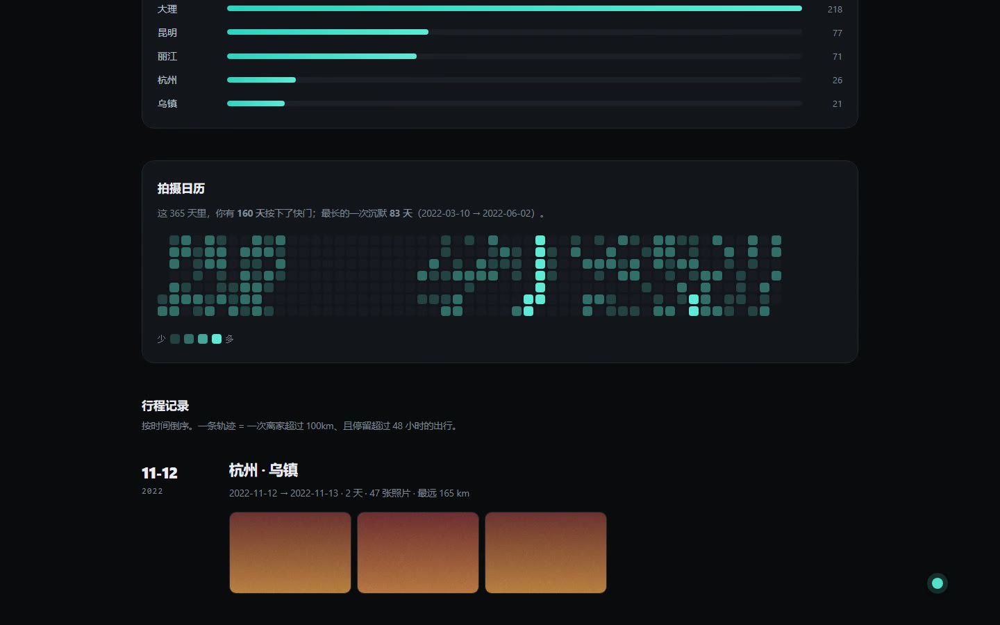

# 演示视频 · 分镜与构建

> **已经有一个生成好的版本**：[`video/demo.mp4`](../video/demo.mp4)（79 秒，1440×900，6 MB）
>
> 画面是**真实浏览器录屏**（CDP 逐帧抓取），配音是 Edge TTS 的 `zh-CN-XiaoxiaoNeural`。
> 全程可复现：`python video/build.py`。
>
> 下面第一节是已生成版本的镜头表；第二节「手录版」是给你自己重录时用的。



---

## 一、已生成的版本（79 秒 / 8 个镜头）

| # | 时间 | 画面 | 旁白 |
|---|---|---|---|
| 01 | 0:00 | 2022 年拍摄日历，中间整块空白 | 三千七百多张照片。最难被算出来的，不是你去过哪。 |
| 02 | 0:07 | 入口页，缓慢下移 | 我做了个小工具，把相册变成一份年度报告。不注册，不上传，也不用装任何东西。 |
| 03 | 0:16 | 拖拽入口页 | 相册拖进去就行。照片在你自己的电脑上读出来，算完直接出报告——一张都不会上传。 |
| 04 | 0:26 | 报告首屏，四个数字 | 三千七百多张照片，最后变成这几个数字。这些不是我填的，是从每张照片的元数据里算出来的。 |
| 05 | 0:36 | 地图，点开新疆那趟行程 | 点开一次行程，地图会放大到那一次的路线。新疆那趟走得最远。 |
| 06 | 0:46 | 切回 2022，日历空白块 | 然后是这块空白。二〇二二年三月到六月，一张照片都没有。报告自己把它算成了一句话：最长的一次沉默，八十三天。 |
| 07 | 0:59 | 页面底部「这份报告有多可信」 | 页面底部还写着另一件事：多少张没有定位，多少张的时间不可信，剔掉了几个异常点。 |
| 08 | 1:09 | 回到首屏定格 | 一个不告诉你哪里可能错的报告，不值得信。全部，都在你自己的电脑上完成。 |

### 它是怎么生成的

```bash
python -m pip install --target _vendor edge-tts imageio-ffmpeg
python -m http.server 8931          # 另开一个终端，抓帧要走 HTTP
python video/build.py               # 配音 → 抓帧 → 合成
```

`video/build.py` 负责配音和拼接，`video/capture.mjs` 用 CDP 驱动无头 Chrome 抓帧。

**关键设计：画面里的运动由「帧序号」驱动，不由墙钟驱动。**
抓一帧要 100–200ms，如果按真实时间滚动，成片里会快得离谱；
改成每帧只推进 `1/N` 的滚动距离，抓多慢都不影响成片速度。

改成重新配音（不重抓帧）：`python video/build.py --reuse-frames`。

---

## 二、如果你想自己手录一版

> 下面是给真人录制用的脚本，节奏和上面那版略有不同。

---

## 拍摄前 10 分钟

```bash
python tests/make_demo_photos.py     # 生成 1,603 张带 EXIF 的 JPEG 到 demo_photos/
python -m http.server 8931           # 起本地服务
```

打开 `http://localhost:8931/web/app.html`，确认能拖。

**桌面清理**：关掉所有通知、隐藏书签栏、清空桌面图标、关掉聊天软件。
**录制**：1920×1080，浏览器缩放 100%，关掉其他标签页。
**素材准备**：把 `demo_photos` 文件夹放在屏幕左侧，方便拖拽。

> ⚠️ 千万别拖 `demo/photos`——那批占位图没有 EXIF，会直接报「没有定位信息」。
> 要拖的是 `demo_photos`。

---

## 分镜

### 00:00 – 00:10 · 冷开场（10s）

| | |
|---|---|
| **画面** | 报告页，`2022` 标签下，镜头缓慢推向日历上那块空白 |
| **操作** | 无。提前开好这一屏，录的时候只做鼠标轻推 |
| **字幕** | 大字叠在空白处：**83 天** |
| **旁白** | 这一千六百张照片里，最难被算出来的，不是你去过哪。 |

### 00:10 – 00:22 · 它是什么（12s）

| | |
|---|---|
| **画面** | 切到 `index.html` 首屏，缓慢下滚半屏 |
| **操作** | 只滚动，不点击 |
| **旁白** | 我做了个小工具，把相册变成一份年度报告。不用注册，不用上传，也不用装任何东西。 |

### 00:22 – 00:36 · 真的拖一次（14s）

| | |
|---|---|
| **画面** | `web/app.html`，把 `demo_photos` 文件夹拖进虚线框 |
| **操作** | 拖拽要慢，悬停在框上停 0.5 秒再松手 |
| **旁白** | 照片在浏览器里读元数据，算完直接出报告——一张都不会离开这台电脑。 |

### 00:36 – 00:45 · 进度（9s）

| | |
|---|---|
| **画面** | 进度条从 2% 走到 100% |
| **操作** | 后期加速 4 倍 |
| **旁白** | 一千六百张，十几秒。 |

### 00:45 – 01:00 · 结果（15s）

| | |
|---|---|
| **画面** | 报告首屏，四个数字依次出现 |
| **操作** | 鼠标停在数字区，不要动 |
| **旁白** | `__` 次远行，`__` 座城市，最远 `__` 公里。这些不是我填的，是从每张照片的元数据里算出来的。 |

> ✍️ 录制前先跑一遍，把 `__` 换成屏幕上的真实数字。数字对不上比没有数字更糟。

### 01:00 – 01:16 · 地图（16s）

| | |
|---|---|
| **画面** | 地图 → 点「乌鲁木齐·喀什」那张行程卡 → 地图放大出那条长线 |
| **操作** | 点击，等放大动画结束再移动 |
| **旁白** | 点开一次行程，会放大到那一次的路线。那趟新疆走得很远——地图上那条线，是几天的照片连起来的。 |

### 01:16 – 01:36 · 沉默（20s）

| | |
|---|---|
| **画面** | 点 `2022` 标签 → 日历整块空白 → 镜头推近 |
| **操作** | 点击年份，停 1 秒再推镜头 |
| **旁白** | 然后是这个。2022 年 3 月到 6 月，一整块是空的，一张照片都没有。报告自己把它算成了一句话：最长的一次沉默，83 天。 |

### 01:36 – 01:50 · 诚实（14s）

| | |
|---|---|
| **画面** | 滚到页面底部「这份报告有多可信」面板 |
| **操作** | 匀速滚动，停在面板上 |
| **旁白** | 底部还写了另一件事：多少张没有定位，多少张的时间不可信，剔掉了几个异常点。一个不告诉你哪里可能错的报告，不值得信。 |

### 01:50 – 02:00 · 收尾（10s）

| | |
|---|---|
| **画面** | 滚回顶部，定格在首屏。叠加 URL |
| **操作** | 无 |
| **旁白** | 全部在你自己的电脑上完成。链接在下面。 |

---

## 旁白全文（约 330 字，念完 1 分 50 秒）

> 这一千六百张照片里，最难被算出来的，不是你去过哪。
>
> 我做了个小工具，把相册变成一份年度报告。不用注册，不用上传，也不用装任何东西。
>
> 照片在浏览器里读元数据，算完直接出报告——一张都不会离开这台电脑。
>
> 一千六百张，十几秒。
>
> `__` 次远行，`__` 座城市，最远 `__` 公里。这些不是我填的，是从每张照片的元数据里算出来的。
>
> 点开一次行程，会放大到那一次的路线。那趟新疆走得很远——地图上那条线，是几天的照片连起来的。
>
> 然后是这个。2022 年 3 月到 6 月，一整块是空的，一张照片都没有。报告自己把它算成了一句话：最长的一次沉默，83 天。
>
> 底部还写了另一件事：多少张没有定位，多少张的时间不可信，剔掉了几个异常点。一个不告诉你哪里可能错的报告，不值得信。
>
> 全部在你自己的电脑上完成。链接在下面。

---

## 剪辑提示

- **进度条那 9 秒加速 4 倍**，观众不想看加载，但需要知道「它在干活」
- **每次点击前留 0.3 秒**，让人看清鼠标落在哪
- **字幕**：只用一种字号两种用途（大字情绪、小字说明），不加动效
- **BGM**：低调的环境音或钢琴，音量压到 −22dB，别盖过人声
- **结尾**：定格 2 秒再淡出，方便平台自动循环

## 常见翻车

| 现象 | 原因 |
|---|---|
| 拖进去报「没有定位信息」 | 拖成了 `demo/photos`，要拖 `demo_photos` |
| 页面卡住不动 | 标签页太多；录制前只留一个 |
| 地图是一片空白 | 断网了，Leaflet 没加载；会降级成 SVG 简图，但录出来不好看 |
| 报告页空白 | 用的是 `file://` 打开的，浏览器禁了 sessionStorage；必须走 `http://localhost` |

## 一鱼两吃

这段录屏可以直接拆成三份素材：

1. **完整版 2 分钟** → 简历链接、GitHub README 顶部
2. **15 秒无声版**（只要 00:00–00:10 + 01:16–01:36）→ 即刻、小红书
3. **GIF**（00:22–00:45 的拖拽段，加速后 4 秒）→ README 里替代静态图
